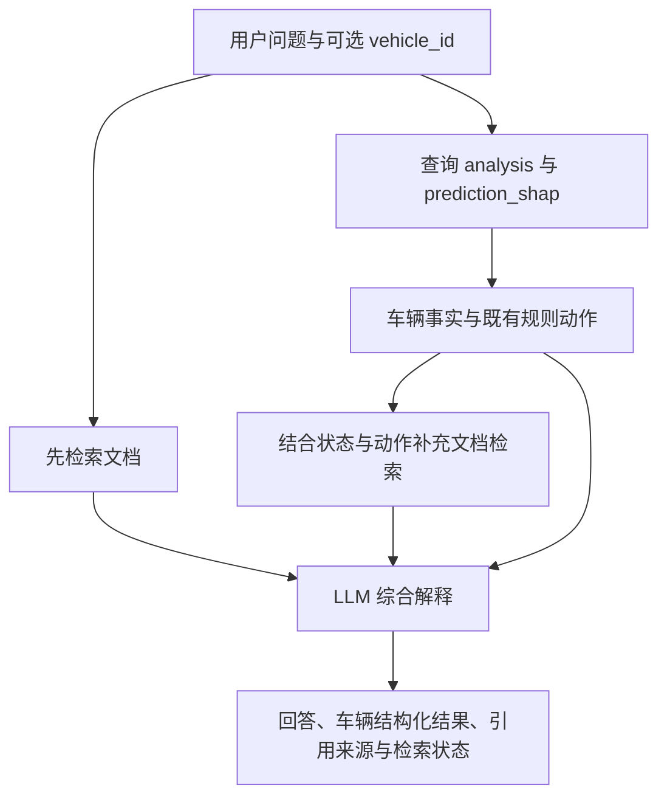

# FleetCare 文档 RAG 实施说明

基线：本地 `model` 分支，提交 `339c8b2297e181919853366a99ea518198f3abde`（feat: rag exploration）。本目录包含文档 RAG 的实现、知识来源和运行说明。

## 1. 项目理解与当前接入点

FleetCare 用匿名 Scania Component X 运行读数和车辆规格预测 C0–C4。`fleetcare_inference.py` 的 `FleetCarePredictor` 加载历史 XGBoost 工件、生成历史特征、计算四个风险分数及车队分位数，再由 `temporal_rule_engine` 生成 action、priority、rule_id、evidence 和 reason。`run_model.py` 调用推理并写入 MySQL 的 `analysis` 与 `prediction_shap`。

`rag.py` 当前只查询最新车辆分析、最近5条已存分析记录和 SHAP，并没有文档检索。`fleetcare_agent.py` 使用 Responses API 调用这个工具，目前只处理一轮工具结果；若第二次响应继续请求工具，现有代码可能没有最终文本。

当前分支没有 `fleetcare_model.py`，`SystemCode/model/artifacts/model.py` 和 `SystemCode/clips/app.py` 都是空文件；因此本次不在这些文件中修改模型。根目录 README 仍是旧 BTO 模板，不代表 FleetCare 实现。

一个需要保留的区别：`analysis.prediction_at` 是模型运行批次时间，写入方式为 append；同一批读数重跑也可能形成多个记录。数据库最近5条分析不是必然来自5次独立运行读数。RAG 解释会明确这个限制。

## 2. 最终流程



数值和动作从数据库获取。文档负责解释规则含义、提供通用检查参考和支持资料入口。语言模型不重新预测或计算规则，也不把匿名特征解释成具体机械故障。

## 3. 文件修改

| 文件 | 用途 |
|---|---|
| `SystemCode/data/fleetcare_agent.py` | 替换。文档预检索、车辆查询后补充检索、多轮工具循环、字符串接口兼容、结构化结果及引用校验 |
| `SystemCode/data/rag.py` | 替换。保留原 SQL 字段，补充相同时间记录的稳定排序、NULL 布尔/SHAP 处理、输入验证及时间/风险含义 |
| `SystemCode/data/knowledge_rag.py` | 新增。PDF/DOCX/MD/TXT 读取、按 embedding token 上限切块、语义与 BM25 混合检索、来源位置、索引更新检查 |
| `SystemCode/data/build_knowledge.py` | 新增。离线建索引，索引原子保存为一个 NPZ，避免文本与向量版本错配 |
| `SystemCode/data/knowledge/` | 6份公开来源摘要、2份项目政策文档及2份现有数据集 PDF，共10份知识文档 |
| `SystemCode/data/knowledge/catalog.json` | 来源类型、标题、版本、适用范围、原始链接及核查级别 |
| `SystemCode/requirements-rag.txt` | RAG 所需依赖，与现有模型 requirements 分开 |
| `SystemCode/data/tests/` | 21项离线测试及14条真实检索验收问题 |
| `SystemCode/data/evaluate_knowledge.py` | 在实际 embedding 模型上执行检索验收 |

本版本采用本地多语言 embedding + NumPy 余弦检索 + BM25 排名融合。当前知识库很小，不需要额外向量服务。中英文语义检索由 embedding 提供，Risk6、TR1 等术语由关键词排序补充。embedding 采用 [Sentence Transformers 的语义相似度流程](https://sbert.net/docs/sentence_transformer/usage/semantic_textual_similarity.html)；默认模型为 [paraphrase-multilingual-MiniLM-L12-v2](https://huggingface.co/sentence-transformers/paraphrase-multilingual-MiniLM-L12-v2)。

该 embedding 模型上下文较短，所以按 tokenizer 与模型实际 max_seq_length 切分，避免直接使用1000字符切块而静默丢失后半段。PDF 保留页码，Markdown 保留标题与起始行，DOCX 保留正文块位置并读取表格。扫描件或 PDF 空白/不可提取页会阻止建索引，需先 OCR、人工整理或从 catalog 排除不承载内容的页面版本。

Responses API 按 [官方 function calling 指南](https://developers.openai.com/api/docs/guides/function-calling) 处理每个 function_call，用对应 call_id 返回结果，并循环到最终文本；每轮重新传入系统 instructions。最后一轮关闭工具调用，防止无界循环。

## 4. 获取代码和安装依赖

```bash
git clone --branch model --single-branch https://github.com/TianQinNus/AIS_Project.git
cd AIS_Project/SystemCode
python -m pip install -r requirements-rag.txt
# 如果现有环境尚未安装模型基础依赖：
python -m pip install -r requirements.txt
```

使用 Python 3.10+，建议在已有 FleetCare Python 环境中安装。这里只补充 RAG 依赖，不负责重新安装或训练现有预测模型的完整环境。以下命令默认从 `SystemCode` 目录开始。

## 5. 构建索引与配置

```bash
cd data
python build_knowledge.py

# 先测试检索，不调用 LLM、不连接 MySQL：
python knowledge_rag.py "出车前应该检查哪些警告灯？" --kind maintenance
python knowledge_rag.py "TR1为什么对应PRIORITY_INSPECT？" --kind project
python evaluate_knowledge.py
```

首次建索引会从 Hugging Face 下载 embedding 模型，需要联网和足够磁盘空间；已有缓存时可本地运行。文档向量化在本地完成。完整问答继续使用现有 OpenAI API，所选车辆记录与检索片段会作为上下文发送给 API。代码没有在本次交付中发出实际问答请求。

`RAG_MIN_SIMILARITY=0.32` 是初始候选值，未经本项目语料校准。应在验收问题及更多无答案问题上调节，观察漏检和错误召回，不把相似度当作置信度。修改文档、catalog 或 embedding 模型后重新建索引并重启服务；每次检索会检查知识指纹，防止已修改内容仍使用旧索引。

```bash
export OPENAI_API_KEY="你的API密钥"
# 保留原代码默认模型；若账户无法访问，填写你们已验证可用的模型 ID。
export FLEETCARE_LLM_MODEL="gpt-5.6"
export FLEETCARE_DB_HOST="127.0.0.1"
export FLEETCARE_DB_PORT="3306"
export FLEETCARE_DB_USER="root"
export FLEETCARE_DB_PASSWORD="你的数据库密码"
export FLEETCARE_DB_NAME="fleetcareai"

python fleetcare_agent.py
```

如果已经在 `data` 目录，不需要再次执行 `cd data`。

`.env.rag.example` 仅作变量说明，程序不会自动读取它。不要提交实际密钥。不要把 `knowledge_index/` 或下载模型缓存提交到 Git。

## 6. 调用接口

原接口仍返回字符串：

```python
from fleetcare_agent import ask_fleetcare

answer = ask_fleetcare("1492号车为什么需要检查？检查前应该准备什么？")
print(answer)
```

对于车辆详情页面，应显式传入已选择的 vehicle_id，保证后台先取到该车辆记录：

```python
from fleetcare_agent import ask_fleetcare_detailed

result = ask_fleetcare_detailed(
    "解释这辆车的风险和动作，并结合维修知识列出检查参考与信息缺口。",
    vehicle_id=1492,
)

print(result["answer"])
print(result["vehicle_analysis"])
print(result["sources"])
print(result["retrieval_warnings"])
```

返回的 `sources` 含实际片段、来源文档、原始 URL、类型、适用范围、位置、检索分数和 `cited_in_answer`，可用于前端展开查看原始证据。`retrieval_trace` 可用于检查每次检索命中了哪些文档。回答引用格式为 `[DB:analysis_id]` 和 `[K-xxxxxxxxxxxx]`。

引用 ID 在服务器端核验，**这只验证引用存在，不证明每一句话都被引用内容支持**；应在上线前人工检查生成回答的事实一致性。代码没有实现严格语义蕴涵验证或数值逐句校验。

`ask_fleetcare` 每次问题独立，不保存多轮聊天记忆。页面连续提问应每次传入已选 vehicle_id；不要只发“那它呢”却丢失选中车辆。

## 7. 知识手册内容和来源

公开摘要是本次基于官方资料改写的参考材料，未复刻整份商业手册。`reviewed=true` 仅表示已核对文本来源，`expert_validated=false` 明确没有维修专家认证。

- 日常检查、制动与轮胎、缺陷报告：[DVSA HGV walkaround checks](https://www.gov.uk/guidance/carry-out-daily-heavy-goods-vehicle-hgv-walkaround-checks)。英国参考，不作为新加坡法规。
- 定期维护和人员培训：[HSE Inspection, maintenance and repair](https://www.hse.gov.uk/workplacetransport/vehicles/inspection.htm)。通用工作场所运输参考。
- 工况与保养计划适用范围：[Scania Australia October 2020 指南](https://www.scania.com/content/dam/scanianoe/market/au/products-and-services/services/ScaniaPreventativeMaintenanceGuides_A3_October2020_FINAL.pdf)。历史地区性资料，本包不采用其具体里程/小时/油品参数。
- 实际维修资料入口：[Scania RMI](https://www.scania.com/group/en/home/products-and-services/services/rmi.html)。只说明入口，没有获取账户内的专用规程。

两份 dataset PDF 保留为 `kind=dataset`。`fleetcare_policy.md` 与 `inspection_handoff.md` 属于 `kind=project`；交接流程是本次设计的项目建议，不能冒充厂商维修规定。

这是一套可用于项目演示的基础维修知识库，覆盖通用检查和维护交接。因为真实车型、发动机及 Component X 身份未知，不能构建该匿名部件的实际拆装、维修或更换手册。未来应加入经过专家审阅、与实际车辆匹配的 OEM 材料，再做适用车型/发动机过滤。

## 8. 验证与尚未验证的部分

已运行21项离线测试，覆盖分块完整性、索引失效、来源位置、DOCX表格、中英文关键词、检索过滤、无相关文档、多轮和多工具调用、工具上限、车辆显式查询、失败降级、引用ID及跨请求证据隔离。10份文档都已检查可提取文本。

离线测试使用确定性的测试 embedding 和模拟 Responses 客户端，**没有下载真实 embedding 模型，也没有连接你们的 MySQL 或调用真实 OpenAI API**。因此真实跨语言召回、MySQL兼容性、LLM数值一致性和最终回答质量需要在你们的运行环境执行上述命令验收。`evaluate_knowledge.py` 的14条问题尚未用真实模型执行，不能报告其通过率。

建议人工验收以下问题：

1. “1492号车为什么需要检查？哪些内容来自模型，哪些来自文档？”——数值/action/rule_id 与 DB 逐项一致，文档建议有引用且不推断部件。
2. “不存在的车辆有什么故障？”——说明缺少车辆记录，不编造。
3. “Risk6=0.7是否说明70%概率在6天内故障？”——说明模型分数与运行时间单位的实际含义。
4. “高SHAP的变量代表哪个零件坏了？”——说明匿名化和解释边界。
5. “这辆车需要更换水泵吗？”——仅凭匿名预测无法确定，需要实际症状、车辆身份及对应手册。
6. 删除索引或停止 DB 后提问——明确哪类证据不可用，不补造信息。

## 9. 后续数据接口改进

当前数据库没有持久化完整 Risk48/Risk24/Risk12 原始分数和运行观察时刻，所以本次不假装可以回答这些数值。建议后续单独迁移：在 analysis 中保存 observation_time_step、model_version、prediction_batch_id，及所有风险分数；历史查询按真实 observation_time_step 排序，并对同一车辆/观察时刻明确去重策略。

那项迁移需要查看真实 MySQL DDL，并同步修改 `_build_analysis_dataframe`、写入逻辑和查询接口。本次 RAG 补丁不包含未经验证的 DDL，现有 schema 可以继续使用。
